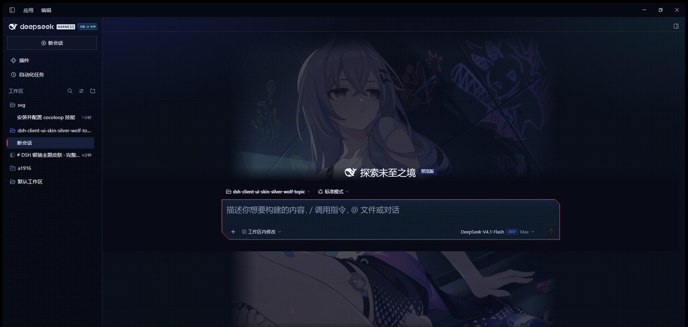

# Silver Wolf // DSH Skin Suite

一个 GitHub 仓库，两个可独立安装的 DSH 包：

- `packages/manager` — `dsh-skin-manager` 0.1.10：设置 → 皮肤，负责切换、互斥和壁纸宽度滑杆
- `packages/skin` — `dsh-skin-silver-wolf-topic` 1.0.11：银狼皮肤本体（CSS、壁纸、头像框、像素动效）

> 这两个包必须**同时安装**。只装皮肤包不会出现“皮肤”设置页；只装管理器只会看到空列表。



## 安装（DSH Desktop）

1. 从 [Releases](../../releases) 下载两个 `.tgz`：
   - `dsh-skin-manager-0.1.10.tgz`
   - `dsh-skin-silver-wolf-topic-1.0.11.tgz`
2. 打开 DSH：**设置 → 插件**，分别安装这两个包。
3. **完全退出 DSH 后重新打开**。
4. 进入 **设置 → 皮肤**，选择“银狼 · 像素骇入”。

实际加载位置是：

```text
%USERPROFILE%\.dsh\profiles\desktop\node_modules\dsh-skin-manager
%USERPROFILE%\.dsh\profiles\desktop\node_modules\dsh-skin-silver-wolf-topic
```

Desktop 是 Electron 保留 profile，**不要使用 `dsh plugin --profile desktop add`**；该命令会被 DSH 拒绝。请走设置里的插件安装面板。

## 浅色/深色

- 聊天区、侧栏和 composer 始终是银狼深色皮肤。
- 设置面板和账户菜单跟随 DSH「外观」设置；浅色模式使用柔和的中性色，而不是纯白。
- 壁纸宽度：设置 → 皮肤 → 银狼 → 壁纸装饰宽度，640–920 px。

## 仓库结构

```text
packages/
  manager/    # dsh-skin-manager（基于 xiaoyangcheng84-svg 的 MIT 框架）
  skin/       # 银狼皮肤包
docs/
  preview.png
scripts/
  checksums.mjs
.github/workflows/
  release.yml
```

## 开发

```sh
pnpm run pack
pnpm run checksums
```

客户端 bundle 是手写的 `window.__ModuleLoader__.load` 格式，不需要额外构建步骤。

## 发布

推送 `v*` tag 会触发 GitHub Actions，生成两个 tgz 和 `SHA256SUMS.txt`，并创建 Release：

```sh
git tag v1.0.11
git push origin v1.0.11
```

## 许可与素材

- `packages/manager`：MIT，原作者 xiaoyangcheng84-svg；本仓库的改动同样以 MIT 提供。
- `packages/skin` 的**代码**：MIT。
- 银狼角色和图片素材来自 `@proglop` 提供的文件；角色与原始美术权利归各自权利人。MIT **不覆盖**这些图片素材，公开前请确认你有权发布。详见 [NOTICE.md](NOTICE.md)。
