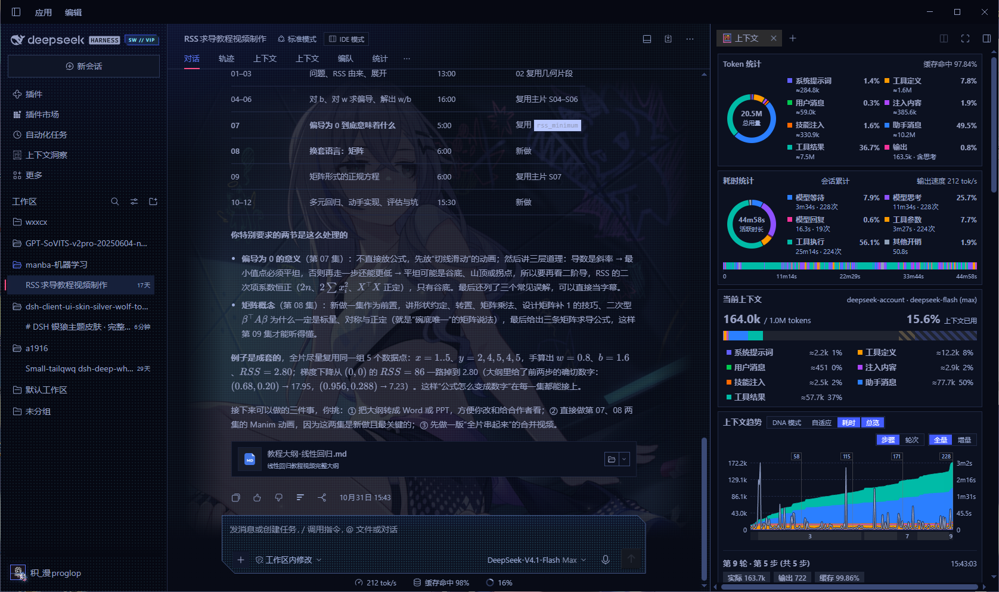

# 银狼 · 像素骇入

[](https://www.npmjs.com/package/dsh-skin-silver-wolf-topic)
[](https://github.com/proglop/dsh-skin-silver-wolf-topic/blob/main/LICENSE)
[](https://github.com/deepseek-ai)

面向 **DeepSeek Harness Desktop** 的深色像素皮肤：蓝紫底、4px 像素网格、实心面板、
直角 UI、聊天区中央银狼装饰，并**内置多皮肤管理器**。

A dark-only, blue-violet pixel skin for DSH Desktop with a built-in multi-skin manager.
It ships its own `settings → 皮肤` page and does **not** depend on the legacy
`dsh-skin-manager` package.



*界面效果预览；角色素材与截图不随 MIT 授权，说明见下方「许可与素材权利」。*

## 目录

- [功能](#功能)
- [环境要求](#环境要求)
- [安装](#安装)
- [使用](#使用)
- [兼容性与已知限制](#兼容性与已知限制)
- [开发与发布](#开发与发布)
- [许可与素材权利](#许可与素材权利)
- [文件结构](#文件结构)

## 功能

- 蓝紫深黑画布、4px 像素格栅、两处霓虹渐变
- 直角与实心面板；全局 `border-radius: 0` + `corner-shape: square` 兜底
- 聊天区中央银狼装饰，随侧栏收展平移
- **设置 → 皮肤**：列出已安装皮肤、查看预览、切换、恢复官方、导入本地皮肤、卸载
- 银狼皮肤专属壁纸宽度滑杆：640–920 px，默认 760 px
- 头像方块、添加文件按钮偏移、随机按钮闪烁均遵守 `prefers-reduced-motion`
- 设置页/portal 与主界面共用同一套皮肤 token；不再出现“主界面有皮肤、设置页还是官方灰底”的割裂
- 不引入外部字体；不修改第三方插件内容

## 环境要求

| 项目 | 要求 |
|---|---|
| DSH | **Desktop 0.2.2-rc.3**（同时兼容 0.2.1-rc.2/rc.3/rc.5、0.2.2-rc.1 的选择器） |
| 外观 | 强制蓝紫深色：即使 DSH 切到浅色外观，主界面、设置页和菜单也使用同一套深色皮肤 |
| 平台 | Windows Desktop 优先；其他平台未做完整验证 |

> Desktop 是 Electron 保留 profile。**不要**使用
> `dsh plugin --profile desktop add ...`，该命令会被 DSH 拒绝；请使用设置里的
> 插件安装入口。

## 安装

### 方式 A：从 npm 安装（发布后）

DSH 桌面端打开 **设置 → 插件 → 安装第三方插件**，填写包名：

```text
dsh-skin-silver-wolf-topic
```

如果你的插件管理器要求显式指定源，请按它的提示填写（部分版本接受
`npm:` 前缀，具体以当前管理器支持为准）。

安装完成后，按**设置 → 皮肤**页面的提示**完全退出 DSH 并重新打开**。
本包会同时注册 `ui-skin-silver-wolf` bundle 行和内置管理器页面，**不要**再单独
安装 `dsh-skin-manager`。

### 方式 B：从 GitHub 安装

```text
github:proglop/dsh-skin-silver-wolf-topic
```

### 方式 C：本地 `.tgz` 安装（开发/离线）

在插件安装入口选择本仓库 `dist/dsh-skin-silver-wolf-topic-1.1.3.tgz`，或直接把
解包后的包目录作为本地插件安装。安装后同样需要完全退出并重新打开 DSH。

### 升级与卸载

- **升级**：在插件管理器里重新安装新版本/新包名，完全退出并重启 DSH。
- **卸载**：先在 **设置 → 皮肤** 点击“恢复官方”，再在插件管理器卸载本包。
- 卸载后管理器页面随包一起消失；内置多皮肤管理器的生命周期与本包相同。

详细步骤与故障排查见 [INSTALL.md](https://github.com/proglop/dsh-skin-silver-wolf-topic/blob/main/INSTALL.md)。

## 使用

1. 完全退出 DSH，再重新打开。
2. 进入 **设置 → 皮肤**。
3. 在皮肤列表中选择“银狼 · 像素骇入”，或导入其他本地皮肤包。
4. 点击“预览”查看效果；点击“恢复官方”关闭皮肤视觉层。
5. 选中银狼后，在列表下方拖动“壁纸宽度”滑杆（640–920 px）。

壁纸宽度保存在浏览器 `localStorage`（`dsh.skin-settings.v1`），不会写入
`cordis.patch.yml`。切换皮肤或导入/卸载后，如果页面提示需要重启，请**完全退出
DSH** 再打开，单纯刷新界面不一定能让插件包变更生效。

## 兼容性与已知限制

- 选择器基准是 **DSH Desktop 0.2.2-rc.3**；CSS module 哈希类名可能随 DSH
  升级变化。技术细节和审计脚本见 [SELECTORS.md](https://github.com/proglop/dsh-skin-silver-wolf-topic/blob/main/SELECTORS.md)。
- **左上角“应用”菜单是 Electron 原生系统菜单，不是网页 DOM**。它的系统圆角
  由 Windows 绘制，皮肤 CSS 无法修改；如需直角只能改 DSH 外壳层（隐藏/替换
  原生菜单），这不属于皮肤包，且可能被 DSH 升级覆盖。
- Windows 原生标题栏、窗口圆角、内嵌浏览器/iframe/canvas 终端内容不在皮肤
  作用域内。
- 本包不重写第三方插件；第三方插件的硬编码颜色不受本皮肤控制。
- 预览图是真实桌面窗口截图，为隐私裁掉了底部无关组件；其版权状态见下节。

## 开发与发布

包内容由 `package.json` 的 `files` 白名单控制。发布前：

```sh
npm pack --dry-run     # 检查实际进入 tarball 的文件
npm pack               # 生成 dsh-skin-silver-wolf-topic-1.1.3.tgz
npm publish --access public
```

发布后可在 npm 页面确认 README、预览图和 `LICENSE` 均已包含。DSH 插件管理器
安装时使用包名，升级时发布新版本号即可。

## 许可与素材权利

本仓库的**代码与文档**（`package.json`、`cordis.patch.yml`、`skin.json`、
`skin.css`、`lib/`、`*.md`）采用 **MIT** 许可，详见 [LICENSE](https://github.com/proglop/dsh-skin-silver-wolf-topic/blob/main/LICENSE)。

`assets/` 下的银狼主题图片（`silver-wolf-chat.png`、`silver-wolf-badge.png`、
`assets/icons/silver-wolf.png` 及 `assets/original/`）以及用于展示效果的
`preview/dark.png`，**不包含在 MIT 许可中，不授予复制、分发或改编许可，保留
所有权利**。这些文件来源于对官方素材的提取、裁剪或描改，不构成本仓库可再
许可的原创作品。

> **发布到 npm 前请注意**：公开 npm 包会一并公开分发上述素材和截图。若你没有
> 公开分发这些角色素材的权利，请不要直接发布包含 `assets/`、`assets/original/`
> 和 `preview/dark.png` 的公开包，或改用私有 registry / 移除相关文件后再发布。
> 本仓库只对代码和文档授予 MIT，不对角色 IP 或素材授予任何许可。

银狼（Silver Wolf）的角色名称、形象及相关知识产权归 **HoYoverse / miHoYo**
所有。本项目是粉丝作品，与 HoYoverse / miHoYo 及 DeepSeek 官方无隶属关系。

## 文件结构

<details>
<summary>点击展开</summary>

```text
dsh-skin-silver-wolf-topic/
├─ package.json
├─ cordis.patch.yml        # 唯一的 ui-skin-silver-wolf bundle 行
├─ skin.json               # 皮肤清单；包含 preview/dark.png
├─ skin.css                # 真实加载的皮肤样式
├─ lib/
│  ├─ index.js             # 资产路由 + 内置多皮肤管理 API
│  └─ client.js            # 皮肤视觉注入 + 设置页管理器
├─ assets/                 # 角色素材，不适用 MIT
│  ├─ silver-wolf-chat.png
│  ├─ silver-wolf-badge.png
│  ├─ icons/silver-wolf.png
│  └─ original/            # 来源存档
├─ preview/dark.png        # 效果预览（含角色素材）
├─ screenshots.json
├─ README.md
├─ INSTALL.md
├─ SELECTORS.md
├─ CHANGELOG.md
├─ LICENSE
└─ ASSETS.md
</details>
```

安装说明：[INSTALL.md](https://github.com/proglop/dsh-skin-silver-wolf-topic/blob/main/INSTALL.md)  
选择器与审计：[SELECTORS.md](https://github.com/proglop/dsh-skin-silver-wolf-topic/blob/main/SELECTORS.md)
